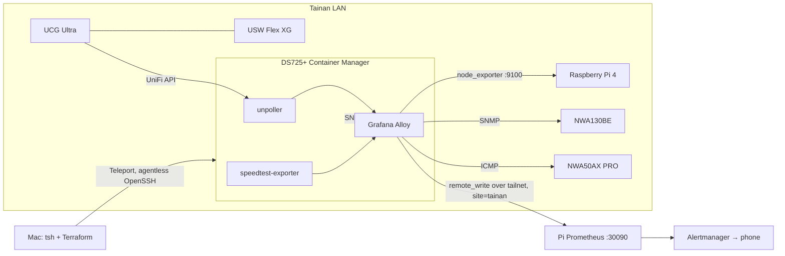

# Tainan site monitoring — setup

The Tainan home is a second site: a Synology DS725+ (tailnet `<nas-tailnet-ip>`), a
UniFi Cloud Gateway Ultra (HiNet 500/500), a USW Flex XG and two Zyxel Nebula APs (NWA130BE,
NWA50AX PRO).

The UCG Ultra has three networks:

| Network | VLAN | Subnet | On it |
|---|---|---|---|
| Default | 1 | same /24 as the Taipei LAN | UCG, USW Flex XG, both APs |
| Work | 10 | `<work-subnet>` | NAS |
| IoT | 107 | `<iot-subnet>` | smart plugs, a Raspberry Pi 4 |

The Pi cannot open connections into Tainan: the Default network uses the same /24 as the Taipei LAN,
so a subnet route would collide, and the tailnet ACL does not let the tagged Pi dial the NAS. The NAS
therefore collects and pushes. Alloy on the NAS reaches the Default network through the UCG, so the
UniFi firewall must allow Work → Default for ICMP and UDP 161.



Terraform for the site lives in `sites/tainan` with its own state, so an expired Teleport certificate can
never break `terraform plan` for the Pi. Alert rules live in the main root
(`modules/prometheus-stack`, group `remote-sites`).

## 1. DSM (Control Panel)

- **Terminal & SNMP → Terminal**: enable SSH on port 22.
- **Terminal & SNMP → SNMP**: untick SNMPv1/v2c. Tick SNMPv3 with user `alloy`, protocol SHA, privacy
  on with AES, and the two passwords from `sites/tainan/terraform.tfvars`.
- **Security → Firewall**: enable, and in the profile add, in this order:
  1. Allow TCP 22 from `<proxy-host-tailnet-ip>` (the Mac running the Teleport proxy).
  2. Deny TCP 22 from all.
  3. Allow UDP 161 from the IP range `172.16.0.1`–`172.31.255.254` (the Alloy container on a Docker
     bridge; DSM rejects a `/12` subnet mask).
  4. Deny UDP 161 from all.

  Leave "if no rules are matched" on **Allow**, so DSM, SMB and the nightly rsync keep working.

## 2. Join the NAS to Teleport (agentless OpenSSH)

On the Mac, create a one-hour join token:

```bash
kubectl -n homelab exec deploy/homelab-teleport-auth -c teleport -- tctl tokens add --type=node --ttl=1h
```

On DSM, **Task Scheduler → Create → Scheduled Task → User-defined script**, user `root`, run once, with:

```bash
set -e
mkdir -p /volume1/@teleport-join && cd /volume1/@teleport-join
curl -fsSL https://cdn.teleport.dev/teleport-v15.5.4-linux-amd64-bin.tar.gz | tar xz
./teleport/teleport join openssh \
  --proxy-server=<teleport-proxy>:443 \
  --join-method=token --token=<TOKEN> \
  --address=<nas-tailnet-ip>:22 \
  --labels=site=tainan,role=nas \
  --openssh-config=/etc/ssh/sshd_config
```

DSM mounts `/tmp` noexec, hence the volume directory. Leave out `set -x`: it would write the token to the
task log. Then turn SSH off and on again in DSM so sshd reloads the Teleport CA. Confirm the node with
`tctl nodes ls`.

**DSM upgrades can rewrite `/etc/ssh/sshd_config`** and drop the `TrustedUserCAKeys` and
`HostCertificate` lines the join added. If SSH through Teleport stops working after an update, run the
task again with a fresh token.

## 3. Let the Teleport login run docker, and put Tailscale in TUN mode

Teleport logs in as `rainforest` (the only login in the `access` role). DSM lets only root use the
Docker socket, and a non-interactive SSH session has no `/usr/local/bin` on its `PATH`, where DSM puts
`docker`. The Synology Tailscale package also starts in userspace networking: containers then cannot
reach the tailnet, so Alloy cannot remote_write to the Pi, and SSH over the tailnet arrives from
`127.0.0.1`, which the firewall rule above cannot match. Add a **Triggered Task → Boot-up**, user
`root`:

```bash
synogroup --get docker >/dev/null 2>&1 || synogroup --add docker
synogroup --get docker | grep -q '\[rainforest\]' || synogroup --memberadd docker rainforest
chown root:docker /var/run/docker.sock
ln -sf /var/packages/ContainerManager/target/usr/bin/docker /usr/bin/docker
/var/packages/Tailscale/target/bin/tailscale configure-host && synosystemctl restart pkgctl-Tailscale.service
```

Run it once by hand after creating it.

## 4. UniFi read access (UCG Ultra)

Pick one:

- **View Only local admin** (least privilege): UniFi OS → Admins & Users → Add Admin, restrict to
  local access, role View Only. Put it in `unifi_user` / `unifi_pass`.
- **API key**: UniFi Network → Settings → Control Plane → Integrations → Create API Key. Put it in
  `unifi_api_key`. The key is not scoped to read-only.

## 5. Nebula SNMP

Nebula site `rainforest-network` → Site settings → Management access: tick **SNMP** and set the SNMPv2
community to `ap_snmp_community` from `terraform.tfvars`. If Nebula's SNMPv3 option takes the same
`alloy` user with SHA and AES, use that instead and set `ap_snmp_auth = "v3"`. Only the NWA130BE
answers; the NWA50AX PRO has no SNMP and is pinged instead.

## 6. Deploy

The cluster runs Teleport 15, so use a 15.x `tsh` (newer clients refuse the version). The CLI cannot use
a browser passkey; add an authenticator app under Account Settings → Multi-factor Devices and log in
with `--mfa-mode=otp`. Certificates last 12 hours.

`tsh config` sets `Port 3022` for every node, the Teleport agent's port. The NAS is an agentless OpenSSH
node on 22, so put a `Port 22` entry for it above the generated block:

```
Host <nas>.<teleport-proxy>
    Port 22
```

```bash
tsh login --proxy=<teleport-proxy>:443 --user=rainforest --mfa-mode=otp
tsh config --proxy=<teleport-proxy> >> ~/.ssh/config
ssh rainforest@<nas>.<teleport-proxy> docker ps   # must list containers

cd sites/tainan
cp terraform.tfvars.example terraform.tfvars   # fill it in
terraform init
terraform plan
terraform apply
```

## 7. Verify

On the Pi Prometheus (`http://<pi-tailnet-ip>:30090`):

- `up{site="tainan"}`: every job is 1 (`isp_icmp`, `lan_icmp`, `snmp`, `unpoller`, `speedtest`, `site-node`).
- `raidStatus{site="tainan"}` and `diskTemperature{site="tainan"}` return the NAS volumes and disks.
- `probe_success{site="tainan", job="isp_icmp"}` is 1 for all three ISP targets.

The `speedtest` job runs once an hour. Each run moves about 1 GB at 500 Mbps.

## 8. Raspberry Pi 4

The Pi 4 is on the IoT VLAN over Wi-Fi. Its eth0 goes to a TP-Link Wi-Fi-to-Ethernet box that runs its
own subnet, which the NAS cannot reach.

### Reply routing

With eth0 up, the Pi's default route goes through the TP-Link, so replies to anything off the IoT subnet
leave by the wrong interface. The UCG can still ping it from the IoT gateway address, but the NAS gets
no answer. Send traffic from the IoT address back out of wlan0, keeping it across reboots:

```bash
sudo nmcli con mod <wifi-connection> \
  ipv4.routes "0.0.0.0/0 <iot-gateway> table=107" \
  ipv4.routing-rules "priority 107 from <rpi4-iot-ip> table 107"
echo 'net.ipv4.conf.all.rp_filter=2' | sudo tee /etc/sysctl.d/90-rp-filter.conf
```

These take effect the next time the Wi-Fi connection comes up. To apply them straight away:

```bash
sudo ip route add default via <iot-gateway> dev wlan0 table 107
sudo ip rule add from <rpi4-iot-ip> lookup 107 priority 107
sudo sysctl -w net.ipv4.conf.all.rp_filter=2 net.ipv4.conf.wlan0.rp_filter=2
```

Give the Pi a fixed IP in UniFi: the rule, the scrape target and the SSH entry all use that address.

### SSH from the Mac

TCP forwarding through the NAS does not work, so `ProxyJump` and `ssh -J` fail with `Connection closed
by UNKNOWN port 65535`, even to a port the NAS itself can reach. The NAS has no `nc`, so relay with bash:

```
Host rpi4-tainan
  HostName <rpi4-iot-ip>
  User rainforest
  IdentityFile ~/.ssh/id_ed25519.rpi4
  IdentitiesOnly yes
  HostKeyAlias raspberrypi-4
  AddKeysToAgent yes
  UseKeychain yes
  ProxyCommand ssh <nas>.<teleport-proxy> "exec bash -c 'exec 3<>/dev/tcp/%h/%p; cat <&3 & cat >&3'"
```

### node_exporter

The playbook binds node_exporter to the Pi's IoT address, so the TP-Link subnet cannot reach it. Other
devices on the IoT VLAN can.

```bash
ansible-playbook -i ansible/inventory-tainan.yml ansible/playbooks/tainan-node-exporter.yml
```

Add the Pi to `lan_ping_targets` and `node_targets` in `sites/tainan/terraform.tfvars`, then apply
`sites/tainan` (this recreates the Alloy container) and the main root (Fleet entry and the
`RemoteSiteHostDown` alert).
